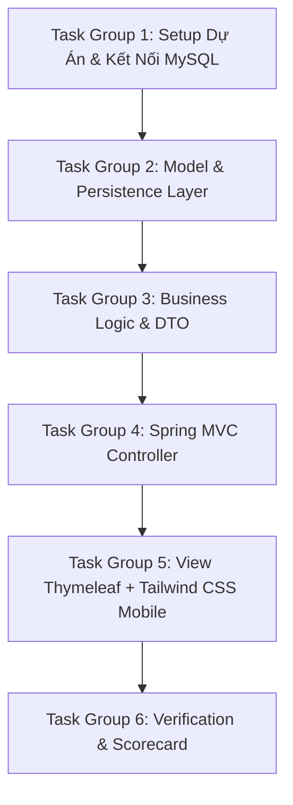

# Implementation Plan: Phase 1 - Quick Transaction Entry
## Sổ Thu Chi Quán Bún (BunLedger)

---

### Mục tiêu tổng quát
Triển khai lát cắt chức năng đầu tiên (MVP) theo mô hình **Spring Boot MVC**: Cho phép chủ quán mở ứng dụng trên điện thoại, nhập nhanh một khoản thu hoặc chi qua form cố định trên đầu trang, tự động gán ngày hiện tại và hiển thị ngay lập tức danh sách các giao dịch gần nhất cùng 3 thẻ tổng kết (Tổng Thu, Tổng Chi, Lợi Nhuận).

---

### Các nhóm công việc tuần tự (Task Groups)

---

#### 📦 Task Group 1: Setup Dự Án & Kết Nối CSDL MySQL
* **1.1.** Khởi tạo cấu trúc dự án Spring Boot 3 Maven:
  * Dependencies: `spring-boot-starter-web`, `spring-boot-starter-data-jpa`, `spring-boot-starter-thymeleaf`, `mysql-connector-j`, `lombok`, `spring-boot-starter-validation`.
* **1.2.** Cấu hình file `application.properties`:
  * Kết nối CSDL MySQL tới database `bunledger_db`.
  * Thiết lập cấu hình tự động cập nhật schema (`spring.jpa.hibernate.ddl-auto=update`).
  * Cấu hình hiển thị SQL log và định dạng thời gian.

#### 📦 Task Group 2: Model & Persistence Layer
* **2.1.** Tạo Enum `TransactionType`:
  * Giá trị: `INCOME` (Khoản Thu), `EXPENSE` (Khoản Chi).
* **2.2.** Tạo Entity `Transaction`:
  * Các trường: `id`, `type`, `itemName`, `amount`, `description`, `transactionDate`, `createdAt`.
* **2.3.** Tạo `TransactionRepository`:
  * Query tìm danh sách giao dịch theo ngày, sắp xếp mới nhất lên đầu: `findByTransactionDateOrderByCreatedAtDesc(LocalDate date)`.
  * Query tính tổng tiền thu trong ngày: `sumAmountByTypeAndDate(TransactionType type, LocalDate date)`.

#### 📦 Task Group 3: Business Logic & DTOs
* **3.1.** Tạo DTO `DailySummaryDto`:
  * Chứa: `date`, `totalIncome`, `totalExpense`, `netProfit` (Lợi nhuận = Thu - Chi).
* **3.2.** Tạo Form DTO `TransactionForm`:
  * Validate: `type` không rỗng, `itemName` không rỗng, `amount` > 0, `description` tùy chọn.
* **3.3.** Xây dựng `TransactionService`:
  * Hàm `saveTransaction(TransactionForm form)`: Tự động gán ngày hiện tại (`LocalDate.now()`).
  * Hàm `getDailySummary(LocalDate date)`: Tính toán tổng thu, tổng chi và lãi ròng.
  * Hàm `getRecentTransactions(LocalDate date)`: Lấy danh sách giao dịch trong ngày.
  * Hàm `deleteTransaction(Long id)`: Xóa một giao dịch theo ID.

#### 📦 Task Group 4: Spring MVC Controller
* **4.1.** Tạo `TransactionController`:
  * `GET /`: Mặc định lấy ngày hôm nay (`LocalDate.now()`), tải danh sách giao dịch và dữ liệu tổng kết, đẩy vào `Model`, trả về view `"index"`.
  * `POST /transactions/save`: Nhận `TransactionForm`, validate hợp lệ, gọi service lưu dữ liệu, chuyển hướng (`redirect:/`) về trang chính.
  * `POST /transactions/{id}/delete`: Nhận yêu cầu xóa, gọi service xóa và chuyển hướng (`redirect:/`) tải lại trang.

#### 📦 Task Group 5: View Thymeleaf + Tailwind CSS Mobile-First
* **5.1.** Xây dựng giao diện `src/main/resources/templates/index.html`:
  * **Header:** Tên quán bún và hiển thị ngày hiện tại (định dạng tiếng Việt: *Hôm nay, ngày DD/MM/YYYY*).
  * **3 Thẻ tóm tắt tài chính (Cards):**
    * Thẻ Tổng Thu (Nền xanh lá nhẹ, chữ số to màu xanh đậm).
    * Thẻ Tổng Chi (Nền đỏ/cam nhẹ, chữ số to màu đỏ đậm).
    * Thẻ Lợi Nhuận Hôm Nay (Nền xanh dương/tím nhẹ, chữ số nổi bật).
  * **Form Nhập Nhanh (Phương án A - Cố định ở đầu):**
    * Toggle 2 nút to chọn: `[+ THU TIỀN]` (Xanh) hoặc `[- CHI TIỀN]` (Đỏ).
    * Ô nhập tên mặt hàng (`itemName`) kèm placeholder gợi ý.
    * Ô nhập số tiền (`amount`) kích hoạt bàn phím số trên điện thoại (`inputmode="numeric"`).
    * Ô ghi chú nhanh (`description`).
    * Nút bấm lớn: `LƯU GIAO DỊCH` (Full chiều rộng màn hình điện thoại).
  * **Danh sách giao dịch gần nhất (Recent Activity):**
    * Hiển thị dạng danh sách thẻ (Card list) thân thiện với mobile.
    * Mỗi dòng thể hiện: Icon Thu/Chi, Mặt hàng, Ghi chú, Giờ nhập, Số tiền (+ hoặc -).
    * Nút biểu tượng [Thùng rác] để xóa nhanh giao dịch nhập sai (có popup xác nhận).

#### 📦 Task Group 6: Verification & Scorecard
* **6.1.** ✅ Kiểm thử luồng nhập thu, chi và xác nhận số liệu tổng kết (Đã hoàn thành qua `BunledgerIntegrationTest`).
* **6.2.** ✅ Kiểm thử trên kích thước màn hình điện thoại di động (Responsive Chrome DevTools / Mobile attributes).
* **6.3.** ✅ Nghiệm thu toàn bộ tiêu chí theo `validation.md` (34/34 tests passed, 100% scorecard passed).

