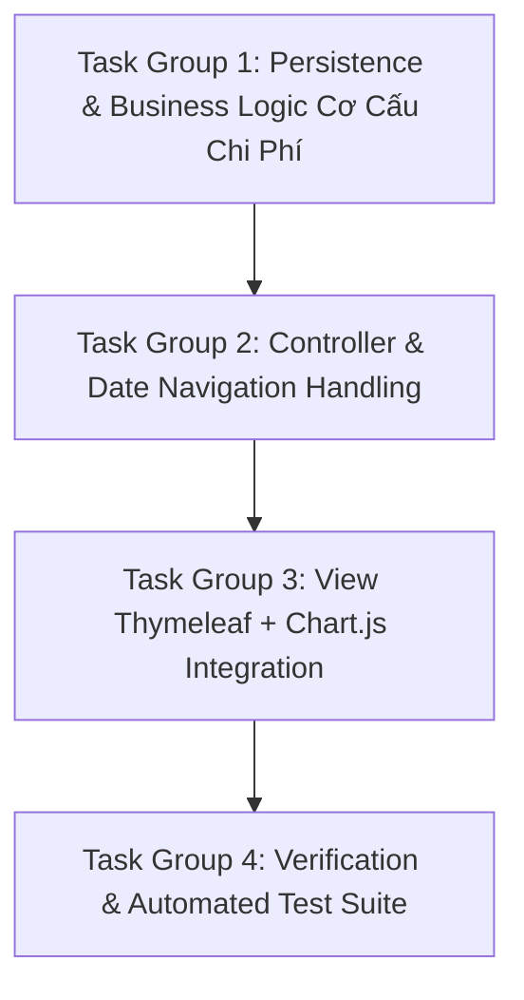

# Implementation Plan: Phase 2 - Charts & Date Navigation
## Sổ Thu Chi Quán Bún (BunLedger)

---

### Mục tiêu tổng quát
Triển khai Phase 2: Bổ sung thanh điều hướng ngày (xem sổ các ngày trước) và tích hợp thư viện **Chart.js** để vẽ 2 biểu đồ vành khuyên trực quan (Thu vs Chi và Cơ cấu mặt hàng chi tiêu).

---

### Các nhóm công việc tuần tự (Task Groups)



---

#### 📦 Task Group 1: Persistence & Business Logic Cơ Cấu Chi Phí
* **1.1.** Tạo DTO `CategoryBreakdownDto` trong `com.bunledger.dto`:
  * Các trường: `String itemName`, `BigDecimal amount`, `BigDecimal percentage`.
  * Helper format tiền tệ VNĐ.
* **1.2.** Mở rộng `TransactionRepository`:
  * Query JPQL gom nhóm chi phí theo mặt hàng trong ngày:
    ```java
    @Query("SELECT t.itemName, SUM(t.amount) FROM Transaction t " +
           "WHERE t.type = :type AND t.transactionDate = :date " +
           "GROUP BY t.itemName ORDER BY SUM(t.amount) DESC")
    List<Object[]> findCategoryBreakdown(@Param("type") TransactionType type, @Param("date") LocalDate date);
    ```
* **1.3.** Mở rộng `TransactionService`:
  * Thêm hàm `getExpenseBreakdown(LocalDate date)`: gọi repository, tính tỷ lệ % trên tổng chi, trả về `List<CategoryBreakdownDto>`.
  * Thêm unit tests cho logic gom nhóm chi phí.

#### 📦 Task Group 2: Controller & Date Navigation Handling
* **2.1.** Cập nhật `TransactionController`:
  * Nhận tham số tùy chọn: `GET /` và `GET /transactions` với `@RequestParam(name = "date", required = false) LocalDate date`.
  * Nếu `date == null` -> gán `today = LocalDate.now()`.
  * Tính các ngày phụ trợ cho Navigation: `prevDate` (`date.minusDays(1)`), `nextDate` (`date.plusDays(1)`), `isToday` (`date.isEqual(LocalDate.now())`).
  * Gọi `getExpenseBreakdown(date)` và serialize dữ liệu thành JSON để truyền vào Thymeleaf View cho Chart.js.
  * Form submit `POST /transactions/save`: Nếu form có `transactionDate`, giữ nguyên ngày đó và redirect về `redirect:/?date=` + date.
  * Thao tác xóa `POST /transactions/{id}/delete`: Nhận tham số `?date=` để redirect về đúng ngày đang xem.
* **2.2.** Viết tests cho Controller xử lý các ngày khác nhau và redirect bảo toàn ngày.

#### 📦 Task Group 3: View Thymeleaf + Chart.js Integration
* **3.1.** Nhúng thư viện Chart.js qua CDN trong `index.html`.
* **3.2.** Thiết kế cụm **Date Navigator**:
  * Nút `[◀]` Lùi 1 ngày, Ô chọn ngày `date input`, Nút `[▶]` Tiến 1 ngày, Nút `Hôm nay`.
  * Tự động reload trang khi người dùng chọn ngày mới trên date input.
* **3.3.** Thiết kế khu vực **Biểu đồ tròn (Chart Section)**:
  * Tab hoặc Grid 2 biểu đồ:
    1. **Biểu đồ 1:** Tỷ trọng Thu vs Chi (Màu xanh Emerald vs Đỏ Rose).
    2. **Biểu đồ 2:** Cơ cấu mặt hàng chi tiêu (Thịt bò, Bún, Rau, Gas...).
  * Xử lý trường hợp ngày chưa có dữ liệu (Hiển thị biểu đồ rỗng xám thanh lịch).
* **3.4.** Cập nhật hidden input `transactionDate` trong Form nhập nhanh để tự động gán ngày đang xem.

#### 📦 Task Group 4: Verification & Automated Test Suite
* **4.1.** Viết kịch bản kiểm thử End-to-End tại `BunledgerIntegrationTest`:
  * Kiểm tra xem sổ ngày hôm qua (`?date=...`).
  * Kiểm tra tính toán cơ cấu chi phí theo từng mặt hàng.
  * Kiểm tra nhập bù giao dịch ngày hôm qua và xác nhận lưu đúng ngày.
* **4.2.** Cập nhật `specs/phase-2-charts-history/validation.md` và kiểm thử toàn bộ test suite.

