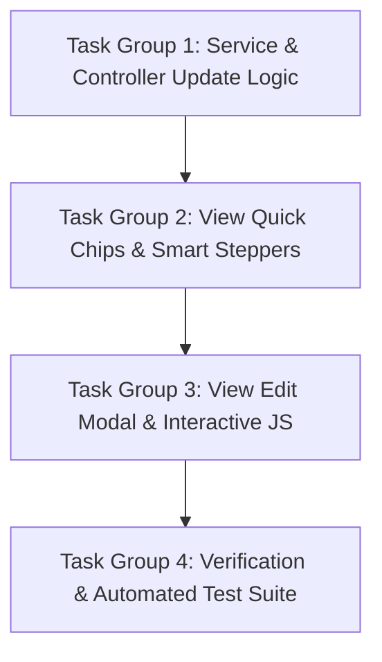

# Implementation Plan: Phase 3 - Mobile UX Polish
## Sổ Thu Chi Quán Bún (BunLedger)

---

### Mục tiêu tổng quát
Triển khai Phase 3: Bổ sung bộ Quick Chips gợi ý tên mặt hàng 1 chạm theo ngữ cảnh Thu/Chi, bàn phím cộng tiền nhanh (+20k, +50k...), và tính năng chỉnh sửa giao dịch (Edit Transaction Modal) với hiệu năng cao trên mobile.

---

### Các nhóm công việc tuần tự (Task Groups)

---

#### 📦 Task Group 1: Service & Controller Update Logic
* **1.1.** Mở rộng `TransactionService`:
  * Thêm hàm `Transaction updateTransaction(Long id, TransactionForm form)`:
    - Tìm kiếm theo `id`, ném ngoại lệ nếu không tìm thấy.
    - Cập nhật các trường: `type`, `itemName`, `amount`, `description`.
    - Bảo toàn `transactionDate` và `createdAt`.
    - Lưu lại vào `transactionRepository`.
  * Thêm hàm `Transaction getTransactionById(Long id)`.
* **1.2.** Mở rộng `TransactionController`:
  * Thêm endpoint `POST /transactions/{id}/update`:
    - Nhận `@PathVariable("id") Long id`, `@Valid @ModelAttribute TransactionForm form`, `BindingResult`, `@RequestParam(name = "date") LocalDate date`, `RedirectAttributes`.
    - Gọi `transactionService.updateTransaction(id, form)`.
    - Thêm flash message `"Đã cập nhật giao dịch thành công!"`.
    - Redirect bảo toàn ngày: `return "redirect:/?date=" + targetDate;`.
  * Thêm unit test và controller test cho `updateTransaction`.

#### 📦 Task Group 2: View Quick Chips & Smart Steppers
* **2.1.** Cập nhật `src/main/resources/templates/index.html`:
  * Thêm cụm **Quick Chips** cuộn ngang ngay dưới ô `itemName`:
    - Chi: `Thịt bò`, `Bún tươi`, `Xương hầm`, `Rau sống`, `Hành ngò`, `Tiền gas`, `Gia vị`, `Đá lạnh`.
    - Thu: `Bún tái gầu`, `Bún giò heo`, `Bún đặc biệt`, `Bún mang về`, `Nước ngọt`, `Khăn lạnh`.
    - Javascript tự động đổi danh sách chip tương ứng khi người dùng chuyển giữa Thu và Chi.
    - Click chip -> Tự điền vào input `itemName`.
  * Thêm hàng nút **Cộng tiền nhanh (Smart Steppers)** dưới ô `amount`:
    - Nút: `+20k`, `+50k`, `+100k`, `+200k`, `+500k`, `[C]`.
    - Tự động cộng dồn số tiền hoặc xóa trắng.

#### 📦 Task Group 3: View Edit Modal & Interactive JS
* **3.1.** Thiết kế **Edit Modal / Bottom Sheet** trong `index.html`:
  * Backdrop mờ, trượt lên mượt mà trên mobile.
  * Form cập nhật với action `/transactions/{id}/update` chứa đầy đủ các trường: Loại giao dịch, Tên mặt hàng, Số tiền, Ghi chú.
  * Nút bấm to "CẬP NHẬT GIAO DỊCH" và nút "HỦY".
* **3.2.** Thêm nút icon [Sửa] bút chì trên từng dòng giao dịch:
  * Click nút Sửa -> Mở modal và nạp sẵn dữ liệu của dòng đó vào form chỉnh sửa.

#### 📦 Task Group 4: Verification & Automated Test Suite
* **4.1.** Mở rộng `BunledgerIntegrationTest`:
  * Kiểm thử luồng chỉnh sửa giao dịch (cập nhật tên và số tiền) -> Xác nhận số liệu tổng thu/chi tính lại chính xác.
* **4.2.** Cập nhật `specs/phase-3-mobile-polish/validation.md` và kiểm thử toàn bộ test suite.

