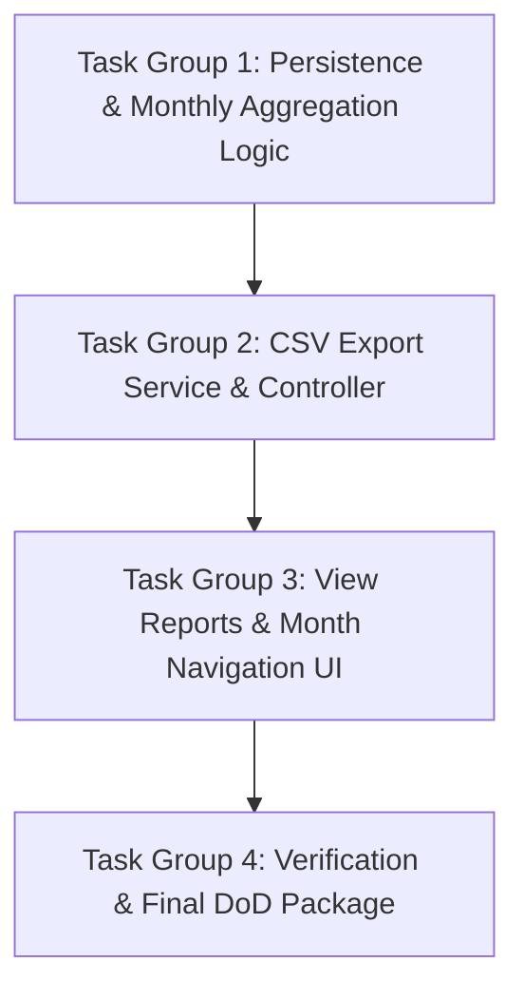

# Implementation Plan: Phase 4 - Reports & Data Export
## Sổ Thu Chi Quán Bún (BunLedger)

---

### Mục tiêu tổng quát
Triển khai Phase 4: Xây dựng màn hình Báo cáo tổng hợp theo tháng (tính tổng thu, tổng chi, lãi tháng, lãi trung bình/ngày, cơ cấu chi tiêu tháng) và chức năng Xuất dữ liệu ra file CSV chuẩn UTF-8 (tương thích Microsoft Excel).

---

### Các nhóm công việc tuần tự (Task Groups)



---

#### 📦 Task Group 1: Persistence & Monthly Aggregation Logic
* **1.1.** Tạo DTO `MonthlySummaryDto`:
  * Các trường: `YearMonth month`, `BigDecimal totalIncome`, `BigDecimal totalExpense`, `BigDecimal netProfit`, `long activeDays`, `BigDecimal averageDailyProfit`.
  * Helper format tiền tệ VNĐ và kiểm tra trạng thái có lãi.
* **1.2.** Mở rộng `TransactionRepository`:
  * Truy vấn tổng tiền theo loại và khoảng ngày (từ ngày đầu tháng đến cuối tháng):
    ```java
    @Query("SELECT COALESCE(SUM(t.amount), 0) FROM Transaction t " +
           "WHERE t.type = :type AND t.transactionDate BETWEEN :startDate AND :endDate")
    BigDecimal sumAmountByTypeAndDateRange(@Param("type") TransactionType type, 
                                           @Param("startDate") LocalDate startDate, 
                                           @Param("endDate") LocalDate endDate);
    ```
  * Truy vấn số ngày có phát sinh bán hàng (distinct date):
    ```java
    @Query("SELECT COUNT(DISTINCT t.transactionDate) FROM Transaction t " +
           "WHERE t.transactionDate BETWEEN :startDate AND :endDate")
    long countActiveDaysBetween(@Param("startDate") LocalDate startDate, 
                                @Param("endDate") LocalDate endDate);
    ```
  * Truy vấn gom nhóm chi phí theo khoảng ngày:
    ```java
    @Query("SELECT t.itemName, SUM(t.amount) FROM Transaction t " +
           "WHERE t.type = :type AND t.transactionDate BETWEEN :startDate AND :endDate " +
           "GROUP BY t.itemName ORDER BY SUM(t.amount) DESC")
    List<Object[]> findCategoryBreakdownBetween(@Param("type") TransactionType type, 
                                                @Param("startDate") LocalDate startDate, 
                                                @Param("endDate") LocalDate endDate);
    ```
* **1.3.** Mở rộng `TransactionService`:
  * `MonthlySummaryDto getMonthlySummary(YearMonth month)`.
  * `List<CategoryBreakdownDto> getMonthlyExpenseBreakdown(YearMonth month)`.
  * `List<Transaction> getTransactionsInMonth(YearMonth month)`.
  * Unit tests kiểm tra logic tính toán tháng.

#### 📦 Task Group 2: CSV Export Service & Controller
* **2.1.** Tạo `CsvExportService`:
  * Hàm xuất dữ liệu ra `Writer` hoặc `byte[]`:
    - Ghi ký tự UTF-8 BOM (`\uFEFF`).
    - Ghi dòng tiêu đề cột tiếng Việt.
    - Duyệt danh sách giao dịch, escape ký tự đặc biệt (dấu phẩy, dấu nháy kép).
* **2.2.** Tạo `ReportController` (hoặc mở rộng `TransactionController`):
  * `GET /reports?month=YYYY-MM`: Trả về view `reports.html` với dữ liệu tóm tắt tháng, cơ cấu chi tiêu tháng và danh sách giao dịch.
  * `GET /export/csv?month=YYYY-MM`: Đặt header attachment và ghi dữ liệu CSV vào `HttpServletResponse`.
  * Viết unit/controller tests cho các endpoint này.

#### 📦 Task Group 3: View Reports & Month Navigation UI
* **3.1.** Xây dựng template `src/main/resources/templates/reports.html`:
  * Thanh Header có nút quay về `[ Sổ Hàng Ngày ]`.
  * Cụm điều hướng tháng: Lùi 1 tháng `[◀]`, input `month`, Tiến 1 tháng `[▶]`.
  * 4 Thẻ tổng hợp tháng: Tổng Thu, Tổng Chi, Lợi Nhuận Tháng, Lợi Nhuận TB/Ngày.
  * Nút to tải xuống: **"XUẤT FILE CSV (EXCEL)"**.
  * Bảng/danh sách cơ cấu chi tiêu trong tháng (tỷ lệ % và số tiền).
  * Danh sách toàn bộ giao dịch trong tháng.
* **3.2.** Thêm nút dẫn sang **"Báo Cáo Tháng"** trên header của trang `index.html`.

#### 📦 Task Group 4: Verification & Final DoD Package (Hoàn thành)
* **4.1.** [x] Viết kiểm thử tích hợp mở rộng trong `BunledgerIntegrationTest`:
  * [x] Kiểm tra tính toán báo cáo tháng và số ngày hoạt động.
  * [x] Kiểm tra endpoint xuất CSV: xác nhận status 200, Content-Type, Content-Disposition và ký tự UTF-8 BOM.
* **4.2.** [x] Nghiệm thu Scorecard `specs/phase-4-reports-export/validation.md`.
* **4.3.** [x] Đóng gói bản phát hành cuối `bunledger-0.0.1-SNAPSHOT.jar` và cập nhật roadmap hoàn thành dự án.

