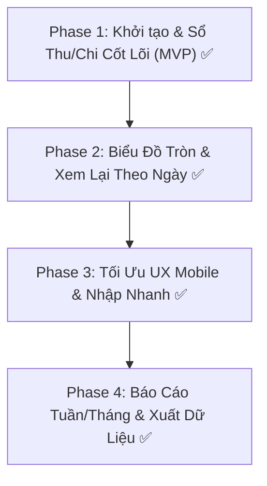

# Implementation Roadmap & Milestones
## Sổ Thu Chi Quán Bún (BunLedger)

---

### Nguyên tắc triển khai theo SDD (Spec-Driven Development)
1. **Chia nhỏ thành các Phase siêu gọn:** Mỗi phase giải quyết một lát cắt giá trị nghiệp vụ hoàn chỉnh (Vertical Slice).
2. **Kiểm thử được ngay:** Mỗi phase đều có tiêu chí nghiệm thu (Acceptance Criteria) rõ ràng, chạy thử và kiểm tra được trước khi chuyển phase tiếp theo.

---

### Lộ trình chi tiết (4 Phases)

---

#### 🟢 Phase 1: Khởi tạo & Sổ Thu/Chi Cốt Lõi (MVP)
* **Mục tiêu:** Xây dựng khung ứng dụng cơ bản, cho phép chủ quán nhập được các khoản thu, chi hôm nay và xem ngay tổng lãi.
* **Nội dung công việc:**
  - Khởi tạo Spring Boot 3 dự án với Maven, kết nối cơ sở dữ liệu MySQL.
  - Tạo tầng Model (Entity, Repository, Service) và Controller (`@Controller`) cho giao dịch (`transactions`).
  - Xây dựng giao diện View với Thymeleaf và Tailwind CSS:
    - Form nhập giao dịch: Loại (Thu / Chi), Mặt hàng, Giá tiền, Nội dung.
    - Bảng danh sách thu & chi của ngày hôm nay.
    - 3 Thẻ chỉ số nổi bật trên đầu trang: **Tổng Thu**, **Tổng Chi**, **Tổng Lãi (Thu - Chi)**.
* **Tiêu chí nghiệm thu (Acceptance Criteria):**
  - [x] Khởi động ứng dụng, tự động kết nối MySQL thành công.
  - [x] Nhập khoản chi: "Thịt bò", 300.000đ -> Danh sách chi cập nhật, Tổng chi = 300.000đ.
  - [x] Nhập khoản thu: "Bún bò bán sáng", 500.000đ -> Danh sách thu cập nhật, Tổng thu = 500.000đ.
  - [x] Hệ thống tính toán chính xác: Lãi hôm nay = 200.000đ.

---

#### 🟢 Phase 2: Biểu Đồ Tròn & Xem Lại Theo Ngày (Visualization & History)
* **Mục tiêu:** Trực quan hóa dòng tiền bằng biểu đồ tròn và cho phép chủ quán xem lại sổ sách của bất kỳ ngày nào trong quá khứ.
* **Nội dung công việc:**
  - Tích hợp bộ chọn ngày (**Date Picker**) tiện lợi trên thanh công cụ.
  - Tích hợp thư viện **Chart.js**:
    - **Biểu đồ tròn 1:** So sánh cơ cấu dòng tiền (**Tổng Thu vs Tổng Chi**).
    - **Biểu đồ tròn 2:** Phân bổ các nhóm mặt hàng chi (để chủ quán biết chi nhiều nhất vào mục nào: thịt, bún, phụ gia, mặt bằng).
  - API trả về dữ liệu tổng hợp theo ngày tương ứng.
* **Tiêu chí nghiệm thu (Acceptance Criteria):**
  - [x] Chọn ngày hôm qua -> Bảng dữ liệu tự động load đúng danh sách của ngày đó.
  - [x] Biểu đồ tròn hiển thị trực quan tỷ lệ % giữa Thu và Chi.
  - [x] Khi thêm/xóa giao dịch, biểu đồ tự động vẽ lại và cập nhật số liệu ngay lập tức mà không cần reload cả trang.

---

#### 🟢 Phase 3: Tối Ưu UX Mobile & Nhập Nhanh (Mobile Polish)
* **Mục tiêu:** Tinh chỉnh trải nghiệm người dùng trên smartphone, giúp chủ quán thao tác bằng một tay cực nhanh tại quầy.
* **Nội dung công việc:**
  - Thiết kế nút bấm gợi ý nhanh (Quick Category Chips):
    - *Thu:* "Bún bò", "Bún tái", "Nước ngọt", "Khăn lạnh"...
    - *Chi:* "Thịt bò", "Bún tươi", "Rau sống", "Hành ngò", "Tiền gas"...
  - Format số tiền tự động khi gõ (ví dụ: gõ `50000` -> tự format `50,000 đ`).
  - Hỗ trợ thao tác Sửa / Xóa khoản giao dịch khi nhập nhầm với thông báo xác nhận.
  - Đảm bảo hiển thị chuẩn Responsive cho mọi độ phân giải màn hình điện thoại phổ thông.
* **Tiêu chí nghiệm thu (Acceptance Criteria):**
  - [x] Bấm 1 chạm vào chip "Thịt bò" -> trường mặt hàng tự điền.
  - [x] Thao tác nhập một khoản thu/chi hoàn tất chỉ trong vòng dưới 5 giây trên điện thoại.

---

#### 🟢 Phase 4: Báo Cáo Tuần/Tháng & Xuất Dữ Liệu (Extensions)
* **Mục tiêu:** Mở rộng báo cáo tài chính định kỳ và đảm bảo sao lưu an toàn cho chủ quán.
* **Nội dung công việc:**
  - Báo cáo tài chính theo Tuần / Tháng: Tổng doanh thu tháng, Tổng chi phí tháng, Lợi nhuận trung bình mỗi ngày.
  - Xuất dữ liệu sổ sách ra file Excel / CSV để chủ quán lưu trữ dự phòng hoặc chia sẻ với gia đình.
* **Tiêu chí nghiệm thu (Acceptance Criteria):**
  - [x] Báo cáo tài chính tháng tổng hợp chuẩn xác từ CSDL MySQL (`GET /reports?month=YYYY-MM`).
  - [x] Tính toán chính xác Lợi nhuận trung bình mỗi ngày bán (`netProfit / activeDays`).
  - [x] Gom nhóm và trực quan hóa cơ cấu chi tiêu trong tháng theo mặt hàng và tỷ lệ %.
  - [x] Bấm nút "XUẤT FILE CSV (EXCEL)" -> tải về file `so_thu_chi_YYYY-MM.csv` chuẩn UTF-8 BOM, mở trên Excel không lỗi font tiếng Việt.
  - [x] Điều hướng hai chiều liền mạch giữa Sổ Ngày (`/`) và Báo Cáo Tháng (`/reports`).
  - [x] 100% ca kiểm thử trong Scorecard đạt trạng thái Passed (115/115 tests toàn dự án).
  - [x] Đóng gói hoàn chỉnh file thực thi `target/bunledger-0.0.1-SNAPSHOT.jar`.

---

### Tổng Kết Tình Trạng Dự Án (Project Completion Status)

| Phase | Tên Giai Đoạn | Mục Tiêu Trọng Tâm | Kiểm Thử & Nghiệm Thu | Trạng Thái |
| :---: | :--- | :--- | :---: | :---: |
| **Phase 1** | Khởi tạo & Sổ Thu/Chi Cốt Lõi (MVP) | Form thu/chi nhanh, 3 thẻ chỉ số ngày hôm nay, kết nối MySQL | 13 tests passed | 🟢 **Hoàn thành [x]** |
| **Phase 2** | Biểu Đồ Tròn & Xem Lại Theo Ngày | Biểu đồ tròn Thu vs Chi & Chi phí, Date picker lịch sử | 32 tests passed | 🟢 **Hoàn thành [x]** |
| **Phase 3** | Tối Ưu UX Mobile & Nhập Nhanh | Quick Chips 1 chạm, Smart Steppers, Edit Modal, Mobile Polish | 78 tests passed | 🟢 **Hoàn thành [x]** |
| **Phase 4** | Báo Cáo Tháng & Xuất Dữ Liệu CSV | Báo cáo tháng, Lãi TB/ngày, Cơ cấu chi, CSV UTF-8 BOM | 115 tests passed | 🟢 **Hoàn thành [x]** |

> **Toàn bộ 4/4 Phases của dự án BunLedger đã được hoàn thành và nghiệm thu 100% theo phương pháp Luận phát triển dựa trên Đặc tả kỹ thuật (Spec-Driven Development - SDD).**
