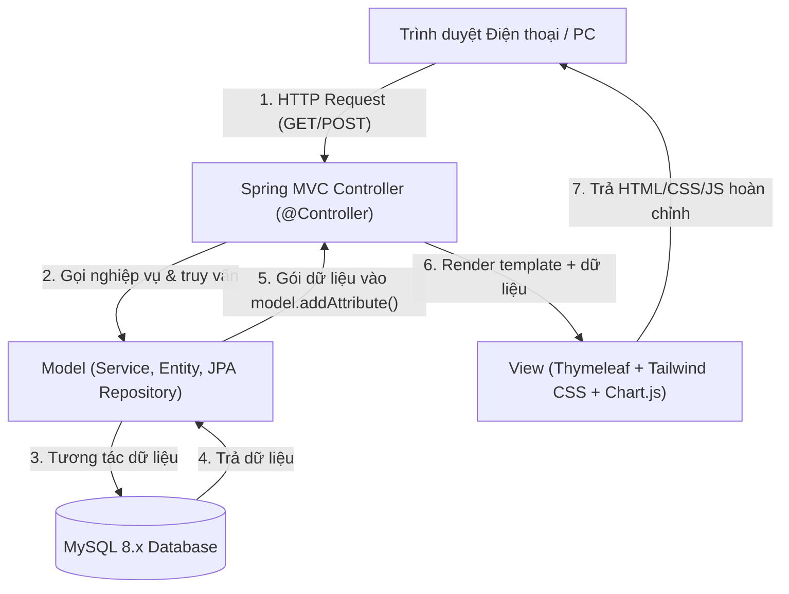

# Technical Architecture & Constraints (Mô hình MVC)
## Sổ Thu Chi Quán Bún (BunLedger)

---

### 1. Kiến trúc tổng thể (Mô hình Spring MVC)
Dự án được xây dựng theo chuẩn **Mô hình MVC (Model - View - Controller)** trên nền tảng **Java & Spring Boot 3**:
* **Model:** Chứa thực thể dữ liệu (`Transaction`), logic nghiệp vụ tài chính (`TransactionService`) và tương tác CSDL (`TransactionRepository` qua Spring Data JPA).
* **View:** Giao diện Server-Side Rendering (SSR) sử dụng **Thymeleaf Template Engine** kết hợp **Tailwind CSS** (tối ưu hiển thị điện thoại) và **Chart.js** (vẽ biểu đồ tròn so sánh thu/chi).
* **Controller:** `@Controller` của Spring MVC tiếp nhận các HTTP Request (GET, POST), xử lý điều hướng, truyền dữ liệu vào `Model` và trả về View hiển thị cho người dùng.



---

### 2. Chi tiết Tech Stack

| Thành phần | Công nghệ được chọn | Vai trò trong mô hình MVC |
| :--- | :--- | :--- |
| **Backend Core** | Java 17/21 + Spring Boot 3.x | Nền tảng điều phối toàn bộ ứng dụng MVC |
| **Controller** | Spring Web (`@Controller`) | Tiếp nhận yêu cầu, xử lý form submit, điều hướng trang |
| **Model** | Spring Data JPA (Hibernate) | Quản lý Entity, Repository và tính toán lãi/lỗ |
| **Database** | MySQL 8.x | Lưu trữ bền vững dữ liệu sổ sách thu/chi |
| **View (Template Engine)** | Thymeleaf | Render trang HTML động từ server |
| **UI Styling** | Tailwind CSS (CDN/Static) | Giao diện Responsive tối ưu Mobile-first cho quán ăn |
| **Data Visualization** | Chart.js | Vẽ biểu đồ tròn (Pie/Donut) so sánh tỷ lệ Thu - Chi |
| **Tiện ích** | Lombok, Jakarta Validation | Giảm code thừa, kiểm tra tính hợp lệ dữ liệu (số tiền > 0) |

---

### 3. Phân rã các tầng trong Mô hình MVC

#### A. Tầng Model (`com.bunledger.model`, `service`, `repository`)
* **Entity `Transaction`:** Đại diện cho một khoản thu hoặc chi trong CSDL.
* **Repository `TransactionRepository`:**
  * Kế thừa `JpaRepository<Transaction, Long>`.
  * Các hàm truy vấn: tìm kiếm theo ngày, tính `SUM(amount)` của Khoản Thu, tính `SUM(amount)` của Khoản Chi.
* **Service `TransactionService`:**
  * Xử lý nghiệp vụ: Thêm mới, cập nhật, xóa giao dịch.
  * Tính toán chỉ số: $\text{Lãi ròng} = \text{Tổng Thu} - \text{Tổng Chi}$.
  * Chuẩn bị dữ liệu phân loại để vẽ biểu đồ tròn.

#### B. Tầng Controller (`com.bunledger.controller`)
* **`TransactionController`:**
  * `GET /`: Mặc định hiển thị sổ thu chi của ngày hiện tại (Hôm nay).
  * `GET /transactions?date=YYYY-MM-DD`: Lọc và hiển thị sổ thu chi của ngày được chọn.
  * `POST /transactions/save`: Tiếp nhận form thêm mới khoản Thu / Chi, validate dữ liệu, lưu vào CSDL và redirect về trang ngày tương ứng (`redirect:/transactions?date=...`).
  * `POST /transactions/{id}/delete`: Xóa giao dịch và redirect tải lại trang.
* **`ChartApiController` (Hỗ trợ biểu đồ):**
  * `GET /api/chart-data?date=YYYY-MM-DD`: Cung cấp JSON tỷ lệ Thu vs Chi và cơ cấu danh mục chi để Chart.js cập nhật trực quan.

#### C. Tầng View (`src/main/resources/templates`)
* **`index.html` (Thymeleaf View chính):**
  * **Header & Bộ chọn ngày:** Date picker chuyển đổi ngày xem sổ nhanh chóng.
  * **Summary Cards (Thẻ số):** 3 khối nổi bật: Tổng Thu (màu xanh lá), Tổng Chi (màu đỏ cam), Tổng Lãi (màu xanh dương).
  * **Khu vực Biểu đồ (Chart Section):** Canvas vẽ biểu đồ tròn so sánh tỷ trọng Thu vs Chi và cơ cấu các mặt hàng chi.
  * **Form nhập nhanh:** Form chuyển đổi 2 chế độ: `+ THU TIỀN` và `- CHI TIỀN`, ô nhập giá tiền, mặt hàng, ghi chú.
  * **Danh sách giao dịch:** Hiển thị danh sách các khoản trong ngày với nút xóa/sửa tiện lợi.

---

### 4. Thiết kế Cơ sở dữ liệu (Database Schema)

```sql
CREATE TABLE transactions (
    id BIGINT AUTO_INCREMENT PRIMARY KEY,
    type ENUM('INCOME', 'EXPENSE') NOT NULL COMMENT 'INCOME: Thu, EXPENSE: Chi',
    item_name VARCHAR(100) NOT NULL COMMENT 'Tên mặt hàng/danh mục (VD: Bún bò, Thịt, Tiền gas...)',
    amount DECIMAL(15, 0) NOT NULL COMMENT 'Số tiền bằng VND (không âm)',
    description VARCHAR(255) NULL COMMENT 'Ghi chú chi tiết',
    transaction_date DATE NOT NULL COMMENT 'Ngày phát sinh thu/chi (YYYY-MM-DD)',
    created_at TIMESTAMP DEFAULT CURRENT_TIMESTAMP
);

CREATE INDEX idx_transactions_date ON transactions(transaction_date);
CREATE INDEX idx_transactions_type ON transactions(type);
```

---

### 5. Yêu cầu Phi chức năng & Trải nghiệm (Non-Functional Requirements)
* **Kiến trúc tinh gọn (Single Deployable Unit):** Toàn bộ ứng dụng MVC đóng gói thành một file `.jar` duy nhất, không cần cài đặt node.js hay máy chủ frontend riêng.
* **Mobile First:** Mọi nút bấm, trường nhập liệu đều to rõ, phù hợp với thao tác 1 tay trên điện thoại của chủ quán.
* **Định dạng tiền tệ:** Tự động hiển thị theo định dạng tiền Việt Nam (VD: `35.000 đ`).
* **Validation chặt chẽ:** Kiểm tra số tiền không âm, ngày hợp lệ ngay tại Controller và Form.
